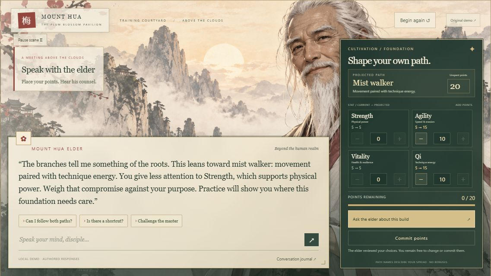
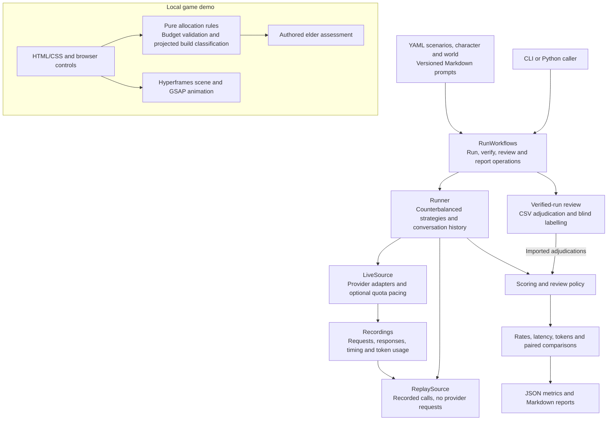

# NPC Dialogue Prompt Bench

Measure how prompt strategies change an LLM-driven game character's dialogue:
character consistency, lore violations, responses to hostile players, latency and
token usage. Runs produce recordings, scored checks and a report that can be
replayed offline and reviewed by a human.

The project is in development. The included synthetic fixtures demonstrate the
workflow; they are not benchmark results or evidence that one strategy is better.

<a href="demos/mount-hua/preview.jpg">
  
</a>

*Local game demo with authored dialogue and free stat allocation. [Run the demo](#interactive-npc-demo).*

## What works today

- Direct replies, generic planning and in-character planning, with counterbalanced
  arm order and multi-turn conversations.
- Fake, Ollama, Anthropic, OpenAI, Groq and Gemini providers, recorded attempts and offline replay.
- Mechanical checks and semantic review flags, CSV adjudication, deterministic
  audit sampling and human-decision precedence.
- Per-arm metrics, paired differences, cluster bootstrap intervals and reports.
- Stratified samples and a local blind-labelling screen.
- Reusable Python run operations through `RunWorkflows`.
- An interactive Hyperframes/GSAP NPC demo with free stat allocation, projected
  build classification and authored elder commentary.

Judge execution and agreement analysis, budget estimation and benchmark freeze guards
are not implemented.

Creation checks input hashes before generation and before publication and rejects
provider metadata that would replace run provenance. Keep inputs unchanged while
a run is executing. Recordings are published after generation completes; interrupted
live runs do not yet have resumable checkpoints. Local labelling serializes writes
within one process; run a single review server per labels file.

## Latest development benchmark

The [Mount Hua pilot](docs/pilots/mount-hua/README.md) gives an original martial-arts
elder a character sheet, explicit game rules and ten scenarios covering build
advice, missing context, insults and false mechanics. On 9 October 2026, three
v4 prompt strategies ran on Qwen through Groq and Gemini: **84 visible replies,
56 private plans and 140 calls**, with no request failures or retries. Both
saved runs replay exactly. No OpenAI API calls were made.

| Model | Direct median | Generic planning median | In-character planning median |
| --- | --- | --- | --- |
| Qwen via Groq | 498 ms | 880 ms | 893 ms |
| Gemini | 1,122 ms | 2,053 ms | 2,115 ms |

Latency includes the planning call where present and excludes quota pacing.
The assistant-reviewed allocation worksheet found 57/60 legal exact splits;
grounding errors, missing clarifications and repetitive voice remained. All
56 plans followed the requested format, but the intended first-person planning
perspective was largely absent. These observations do not establish a general winning strategy.

This is one development family and one replicate, with assistant review rather
than independent human validation. Model reasoning settings differ, and the
results do not establish a general winning strategy. Read the
[full evaluation](docs/pilots/mount-hua/benchmark-2026-10-09.md),
[saved evidence](results/mount-hua-2026-10-09/README.md),
[prompt guide](docs/pilots/mount-hua/prompt-guide.md).

## Install

Use Python **3.12 or newer**. The CI template covers Python 3.12, 3.13 and 3.14 on Linux,
plus Python 3.14 on Windows. Run the commands below from the repository root.

Windows PowerShell:

```powershell
python -m venv .venv
.\.venv\Scripts\Activate.ps1
python -m pip install -e ".[dev]"
```

Linux or macOS:

```bash
python3 -m venv .venv
source .venv/bin/activate
python -m pip install -e ".[dev]"
```

Keep the environment active for the following commands. If PowerShell prevents
activation, use `.\.venv\Scripts\python.exe` for Python commands and
`.\.venv\Scripts\bench.exe` for `bench` commands directly.

## Offline quickstart

These commands use two synthetic scenarios and a fake provider. No API key,
Ollama installation or model download is needed.

```bash
bench run --scenarios tests/fixtures/s1/scenarios.yaml --character tests/fixtures/s1/character.yaml --prompt tests/fixtures/s1/prompt.md --provider fake --model fake-1 --run-id demo --results-dir results
bench replay --run-id demo --results-dir results
bench report --run-id demo --results-dir results
```

Expected output, with the results path depending on your checkout:

```text
Run demo: 2 replies (2 attempts) recorded in <checkout>/results/demo
Replay of demo matches the recorded checks and metrics.
Wrote <checkout>/results/demo/report.md
```

Open `results/demo/report.md` to inspect the metrics. Each run contains:

| File | Contents |
| --- | --- |
| `run_config.json` | Run settings, arm order and input/recording hashes |
| `recordings.jsonl` | Requests, responses, timings, usage and failed attempts |
| `checks.jsonl` | Raw check outcomes and review flags |
| `metrics.json` | Derived metrics, including unresolved outcomes |
| `report.md` | Human-readable results |
| `adjudications.jsonl` | Human decisions, created when adjudications are imported |

Use a fresh run ID for another run. Existing run directories are never
overwritten. Replay needs the original input files and verifies that their
contents, recordings and rebuilt checks still match; run it from the checkout
root. It never falls back to a live provider.

After installation, replay the included live benchmark without API credentials:

```bash
bench replay --run-id groq-v4-full-01 --results-dir results/mount-hua-2026-10-09
bench replay --run-id gemini-v4-full-01 --results-dir results/mount-hua-2026-10-09
```

For a fresh live pilot, the PowerShell launcher accepts `-PromptVersion v4`.
Its default remains v2. Use a fresh run ID and the provider settings in the
[provider guide](docs/pilots/mount-hua/providers.md); a live run consumes quota.

## Human review

Export outstanding adjudications, fill the `verdict` column with `pass`, `fail`
or `unknown`, and import the CSV. Leave verdicts blank to defer a decision.

```bash
bench adjudicate export --run-id demo --results-dir results --out pending.csv
bench adjudicate import --run-id demo --results-dir results --file pending.csv
bench replay --run-id demo --results-dir results
```

Imports validate every row before applying decisions and update the metrics and
report. Reimporting the same decisions leaves artifact contents unchanged.
Semantic flags request review; they do not themselves establish a failure.

To try the blind-labelling screen with the tiny quickstart fixture:

```bash
bench label sample --run-id demo --results-dir results --validation 1 --calibration 1 --seed 4
bench label serve --results-dir results
```

Open [http://127.0.0.1:8765](http://127.0.0.1:8765) while the server runs.
Calibration and validation use different scenario families. A saved sample is
never redrawn in place. This two-reply sample demonstrates the screen; it is too
small for judge validation.

## Use your own inputs

Replace the fixture paths with your scenario YAML, character sheet and prompt.
Use `--arm STRATEGY=PATH` repeatedly to compare prompts; supported strategies are
`direct`, `plan_generic` and `plan_in_character`. A prompt file's stem identifies
its version.

Optional `--world PATH` and `--banned-content PATH` inputs enable the relevant
checks. Use `bench run --help` for all flags and `bench validate --help` for
content-validation options.

For live runs, select a provider and specify your model with `--model`. Ollama
needs a running local server with the model available. Hosted providers read
`ANTHROPIC_API_KEY`, `OPENAI_API_KEY`, `GROQ_API_KEY` or `GEMINI_API_KEY` from the
environment; credentials are not recorded in run artifacts. Live runs can incur
provider charges. The [pilot provider guide](docs/pilots/mount-hua/providers.md)
lists supported models and thinking settings, quota pacing, masked key entry and
an illustrative OpenAI cost calculation. Use `--request-interval SECONDS` to
pace calls without including artificial pauses in measured provider latency.

## Architecture

The project has a reusable Python benchmark and a local browser demo. The
benchmark runs versioned prompts, records model calls, evaluates replies and
rebuilds results offline. The demo presents the elder and point-allocation
interaction using authored dialogue.



| Layer | Main files | Responsibility |
| --- | --- | --- |
| Content and validation | `data/pilots/mount-hua/`, [loaders.py](src/npcbench/loaders.py), [schemas.py](src/npcbench/schemas.py) | Editable scenarios, character/world facts and prompt versions; typed input validation. |
| Public interface | [cli.py](src/npcbench/cli.py), [runs.py](src/npcbench/runs.py) | CLI commands and reusable `RunWorkflows` operations, keeping storage and review ordering behind one interface. |
| Execution | [runner.py](src/npcbench/runner.py), [prompts.py](src/npcbench/prompts.py), [pacing.py](src/npcbench/pacing.py) | Counterbalanced strategy order, multi-turn history, optional plan calls and quota pauses. |
| Model access and replay | [providers/](src/npcbench/providers/), [recorder.py](src/npcbench/recorder.py) | Streaming provider adapters and hashed call recordings. `LiveSource` and `ReplaySource` share the runner's `Source` interface. |
| Evaluation and reporting | [checks/](src/npcbench/checks/), [cohort.py](src/npcbench/cohort.py), [adjudication.py](src/npcbench/adjudication.py), [metrics/](src/npcbench/metrics/), [report.py](src/npcbench/report.py) | Mechanical checks, semantic flags, audit sampling, imported human decisions and descriptive statistics. Unresolved semantic findings remain explicit. |
| Review interface | [review/](src/npcbench/review/) | Local FastAPI labelling screen and sampling helpers; CSV adjudication is available through the run workflow. |
| Game presentation | [allocation.js](demos/mount-hua/allocation.js), [demo.js](demos/mount-hua/demo.js), [scene/](demos/mount-hua/scene/) | Reusable point-allocation logic, browser state, authored feedback and animated presentation. |

Each saved run contains `run_config.json`, `recordings.jsonl`, `checks.jsonl`,
`metrics.json` and `report.md`. Configuration records input hashes; replay
requires matching inputs and recordings. API credentials stay in the live
provider environment and are not saved in run artifacts.

The custom allocation worksheet in this pilot uses assistant transcriptions;
it is separate from the application's automated checks and adjudication import.
The demo makes no model calls. See the [code structure and reuse guide](docs/code-structure.md)
for the public Python interface and operation guarantees.

## Reuse and development

`npcbench.runs.RunWorkflows` provides complete run, verification, export, import
and labelling operations without importing the CLI. The
[code structure and reuse guide](docs/code-structure.md) explains the modules,
result types, guarantees and a working Python example.

Run the Python checks locally:

```bash
python -m ruff check src tests
python -m ruff check scripts/summarize-pilot.py
python -m pytest
```

The [GitHub Actions template](ci/github-actions.yml) defines checksum-verified
Gitleaks history scanning, Python lint and tests, an offline quickstart, and demo checks.
GitHub Actions is not enabled in this public repository. To enable it, copy the template
to `.github/workflows/ci.yml` and push with credentials authorized to update workflows.
Tests block external network connections and use mock HTTP transports. Dependency
installation uses the network; no provider credentials are required for tests.

Local `.env` variants, `secrets/`, `credentials/` and private key/certificate files
are ignored by Git; `.env.example` stays shareable with empty assignments.
The pilot launcher loads `.env` automatically. History scanning does not scan
your ignored local credential file; keep credentials out of tracked files.

## Project documents

- [Methodology](MANIFEST.md): execution, scoring and interpretation rules.
- [Glossary](GLOSSARY.md): domain terminology.
- [Code structure](docs/code-structure.md): where code belongs and how to reuse it.
- [Design decisions](docs/adr/): review cohort and recorded-attempt semantics.

## Interactive NPC demo

Meet the Mount Hua elder in a game-style ink-and-parchment scene, with Hyperframes
and GSAP animation, dialogue choices, free point allocation, and an elder
assessment with descriptive path classification. The original preset-based
demo is preserved under `demos/mount-hua/snapshots/game-v1/`.
See [demo setup and limitations](demos/mount-hua/README.md). Dialogue is authored
for this offline presentation; it makes no API calls.

```powershell
npm.cmd install --prefix demos/mount-hua
python demos/mount-hua/serve.py
```

Open [http://127.0.0.1:8088](http://127.0.0.1:8088). Check its allocation rules and scene:

```powershell
npm.cmd test --prefix demos/mount-hua
npm.cmd run check --prefix demos/mount-hua
```
