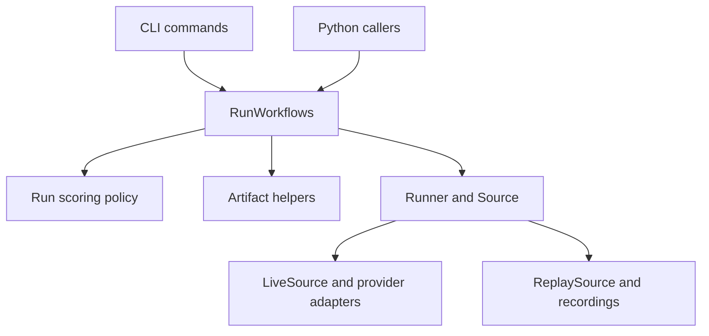

# Code structure and reuse

Use `npcbench.runs.RunWorkflows` for complete run operations. It keeps verified
loading, review policy and artifact updates together. A Python caller uses the
same interface as the CLI and receives values or `RunError`; it does not need to
import `cli.py` or handle a process exit.

## Where code belongs

| Module | Responsibility |
| --- | --- |
| `cli.py` | Flags, provider selection, output files, messages and server launch |
| `runs.py` | Complete run operations and their typed requests and results |
| `_run_analysis.py` | Internal raw checks, audit selection, human precedence and derived metrics |
| `_run_storage.py` | Internal run-path validation and file-format helpers |
| `runner.py` | Scenario execution through the `Source` interface |
| `providers/` | Real and fake `ChatClient` adapters |
| `providers/chat_completions.py` | Shared streamed protocol with explicit OpenAI, Groq and Gemini differences |
| `pacing.py` | Optional pauses between live attempts, outside measured provider latency |
| `scoring.py`, `checks/`, `cohort.py`, `adjudication.py`, `metrics/` | Check, review and statistical algorithms |
| `review/labelling.py`, `review/app.py` | Sampling, blinded fields and the labelling screen |

The modules prefixed with `_run_` are implementation details. New callers should
use `runs.py`. Keep algorithms in their existing modules when they can operate
on values without knowing how a run is stored.



## Task operations

Construct `RunWorkflows(Path("results"))` once, then request an operation:

| Operation | Result and effects |
| --- | --- |
| `create(spec, source=source)` | Publishes a new run and returns its path, reply count and attempt count |
| `verify(run_id)` | Rebuilds checks and metrics offline; returns `None` on a match |
| `export_adjudications(run_id)` | Returns pending-review CSV text and count; writes nothing |
| `import_adjudications(run_id, csv_text)` | Updates decisions, metrics and report; returns imported and stored counts |
| `draw_label_sample(run_id, spec)` | Returns the sample and candidate count; the caller chooses where to save it |
| `prepare_labelling(sample)` | Returns blinded items for the sampled replies; launches no server |
| `render_report(run_id)` | Re-renders the stored metrics and returns the report path; does not replay |

The export sequence is verified replay → raw audit selection → cohort rules →
human decisions → pending reviews → CSV. Callers cannot reorder these steps.
Labelling samples use raw checks rather than adjudicated outcomes.

## Reuse from Python

This example runs offline using the same fake adapter as `bench run`. Run it from
the repository root after installing the project. Use a fresh run identifier.

```python
from pathlib import Path

from npcbench.providers.fake import FakeClient, FakeClock, echo_reply
from npcbench.runner import LiveSource
from npcbench.runs import RunError, RunSpec, RunWorkflows
from npcbench.schemas import Arm

fixtures = Path("tests/fixtures/s1")
clock = FakeClock()
source = LiveSource(FakeClient(reply=echo_reply, clock=clock), clock)
runs = RunWorkflows(Path("results"))

try:
    summary = runs.create(
        RunSpec(
            run_id="python-example",
            scenarios=fixtures / "scenarios.yaml",
            character=fixtures / "character.yaml",
            arm_prompts=[(Arm.of("direct", "prompt"), fixtures / "prompt.md")],
            model="fake-1",
            provider="fake",
        ),
        source=source,
    )
    runs.verify("python-example")
    pending = runs.export_adjudications("python-example")
    Path("pending.csv").write_text(pending.text, encoding="utf-8", newline="")
    print(summary.reply_count, pending.pending_count)
except RunError as error:
    print(error)
```

Supply another `Source` adapter to change generation. Keep credentials in the
adapter; `provider_config` holds only metadata safe to record, such as reasoning
mode. Each arm pairs its identity with a prompt path.

## Guarantees and limits

- Existing run directories are rejected before any `Source.fetch` call.
- Review, sampling, labelling and verification rebuild from recordings without
  calling a provider. Changed inputs, recordings or raw checks fail the operation.
- Inputs within the checkout are recorded as relative paths. Replay should run
  from the corresponding checkout root, with those inputs still available.
- Audit selection is deterministic and uses raw checks. Human decisions are
  applied after cohort rules and take precedence.
- An invalid adjudication CSV applies no rows. Reimporting identical decisions
  leaves artifact contents unchanged.
- Creation writes to staging and publishes a complete directory. Adjudication
  replaces files individually; it has no multi-file crash-recovery guarantee.
- Each evidence-based operation verifies and replays again. There is no cache.
- CLI flags, output formats and the separate `report` behavior remain compatible.

## Verification

`tests/integration/test_run_workflows.py` exercises the public interface with a
fake provider and real temporary files. CLI tests cover flags, messages and the
labelling server. Algorithm and provider tests remain at their existing seams.

```powershell
.\.venv\Scripts\python.exe -m pytest
.\.venv\Scripts\python.exe -m ruff check src tests
```
